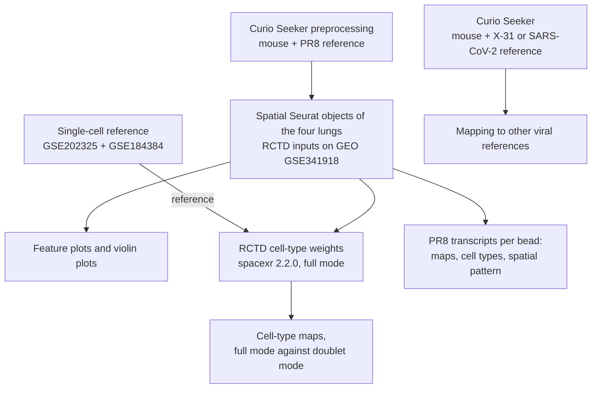

# Flu Paper Codes

Analysis code for the spatial transcriptomics (Curio Seeker) of mouse lungs 4 and 10 days after intranasal
infection with influenza A/PR8 (PR8-OVA), GEO series
[GSE341918](https://www.ncbi.nlm.nih.gov/geo/query/acc.cgi?acc=GSE341918), "Dual host-pathogen screening of the
lung during severe influenza using spatial transcriptomics" (Haque Lab, University of Melbourne).



## Contents

| Folder | What it holds |
|---|---|
| [`scripts/`](scripts) | The main steps with all paths taken from one configuration file |
| [`original_scripts/`](original_scripts) | The files of the original analysis as they are on the cluster, byte for byte, with run logs; origin and md5 of each in [`MANIFEST.tsv`](original_scripts/MANIFEST.tsv) |
| [`figures/generated/`](figures) | 107 output figures and tables of the original runs, with checksums |
| [`environment/`](environment) | Software versions and the conda environment of the RCTD runs |
| [`docs/`](docs) | [`PROVENANCE.md`](docs/PROVENANCE.md): data, runs, references and versions; [`CODE_TO_FIGURE_MAP.md`](docs/CODE_TO_FIGURE_MAP.md); [`REPRODUCIBILITY.md`](docs/REPRODUCIBILITY.md): test results |
| [`config/`](config), [`tests/`](tests) | Configuration templates; a check of the repository that needs no data |

## Analyses

| Step | `scripts/` | `original_scripts/` | Software |
|---|---|---|---|
| 1. Preprocessing | `01_preprocessing/lung_curioseeker_qc.sh` | `01_preprocessing/` | Curio Seeker v2.0.0, Nextflow 23.10.1; mouse mm10 + PR8 reference |
| 2. Feature plots, violin plots | `02_feature_plots/FeaturePlots_Flu.R` | `02_feature_plots/` (two versions) | the 42 feature plots are reproduced with R 4.3.1, Seurat 4.3.0.1 |
| 3. RCTD, days 4 and 10 | `03_rctd/` | `03_rctd/` | R 4.3.3, Seurat 5.1.0, spacexr 2.2.0 |
| 4. Mapping to X-31 and SARS-CoV-2 references | `04_viral_mapping/` | `04_viral_mapping/` | Curio Seeker v3.1.0, Nextflow 23.04.2 |
| 5. Revision analyses: gene-list overlap, cell-type maps, RCTD modes | `05_revision_analyses/` | `05_revision_analyses/` | R 4.3.3, spacexr 2.2.0 |
| 6. PR8 transcripts: maps, cell types, spatial pattern | | `06_viral_expression/` | R 4.3.3, Seurat 5.1.0 |

Settings, SLURM jobs, references and bead numbers of the runs: [`docs/PROVENANCE.md`](docs/PROVENANCE.md).

## Run

1. **Data.** GEO GSE341918 holds the four spatial objects that RCTD reads (`GSM9920041_lungST_2_2_QCed_edit.rds`
   to `GSM9920044_lungST_4_3_QCed_edit.rds`). The single-cell reference is built from GEO GSE202325 and
   GSE184384. All inputs and where they come from: [`data/README.md`](data/README.md). No data are in this
   repository.
2. **Environment.** RCTD: the conda environment of [`environment/README.md`](environment/README.md), with
   spacexr 2.2.0. The feature-plot and overlay scripts need Seurat, spacexr, tidyverse, data.table and mltools.
3. **Configure and run**, from the root of the repository:

```bash
cp config/paths.example.env config/paths.env      # then edit the paths
mkdir -p logs
sbatch --account=YOUR_ACCOUNT --partition=YOUR_PARTITION scripts/03_rctd/mouseDay4RCTD_full_v2.sh
sbatch --account=YOUR_ACCOUNT --partition=YOUR_PARTITION scripts/03_rctd/mouseDay10RCTD_full_v3.sh
set -a; source config/paths.env; set +a
Rscript --vanilla scripts/02_feature_plots/FeaturePlots_Flu.R
Rscript --vanilla scripts/05_revision_analyses/FishersExactTest.R background.txt list_1.txt list_2.txt out.tsv
```

   The RCTD fits took 39 and 15 minutes on one CPU and used 4.5 and 7.8 GiB of memory. More commands:
   [`docs/HPC_EXECUTION.md`](docs/HPC_EXECUTION.md). The files of `original_scripts/` hold the paths of the
   Spartan cluster (University of Melbourne) and are kept as a record.

## Tested

The R scripts of `scripts/` and their SLURM wrappers were run on the original data on 23 November 2026 and
their outputs compared with those of the original runs, or, for the comparison of the RCTD modes, with the
original script run on the same input; the Curio Seeker launchers were checked by their command line. See
[`docs/REPRODUCIBILITY.md`](docs/REPRODUCIBILITY.md).

## About the files

- `original_scripts/` holds the files of the original analysis. `scripts/` holds the same analyses with
  configurable paths; every difference is listed in [`docs/CHANGES_FROM_ORIGINAL.md`](docs/CHANGES_FROM_ORIGINAL.md).
- The figures of `figures/generated/` are the files written by the original runs, unchanged.

## Citation and licence

Cite the article of GEO series GSE341918 and this repository ([`CITATION.cff`](CITATION.cff)). The code is
released under the [MIT License](LICENSE).
